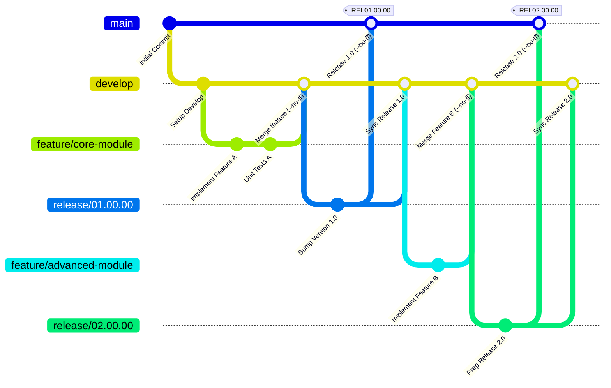

<div align="center">

# 🌿 Advanced Git Flow & Release Management System

**A Practical Implementation of Enterprise Git Flow Branching, Non-Fast-Forward Integration, and Semantic Release Versioning**

[](https://git-scm.com/)
[](https://github.com/)
[](#)
[](#)

<p align="center">
  <a href="#-overview">Overview</a> •
  <a href="#-key-features">Key Features</a> •
  <a href="#-branching-architecture">Branching Architecture</a> •
  <a href="#-workflow--implementation-steps">Workflow Steps</a> •
  <a href="#-release-history--tags">Release History</a> •
  <a href="#-author">Author</a>
</p>

</div>

---

## 📖 Overview

**Advanced Git Flow & Release Management System** is a practical, real-world implementation of the **Git Flow** branching model. It demonstrates enterprise-grade software version control practices by structuring development across isolated `main`, `develop`, `feature/*`, and `release/*` branches.

This repository serves as a blueprint for clean commit histories, explicit feature integration using non-fast-forward merges (`--no-ff`), structured release staging, and immutable milestone tracking via annotated Git tags.

---

## ✨ Key Features

* 🌳 **Strict Git Flow Architecture:** Clear separation between production-ready code (`main`), active integration (`develop`), isolated work (`feature/*`), and release staging (`release/*`).
* 🔗 **Preserved Merge History (`--no-ff`):** Enforces explicit merge commits so the historical context of every feature and release branch remains intact in the commit graph.
* 🚀 **Dedicated Release Pipelines:** Isolates release preparation, final QA, and version bumping without freezing ongoing feature development on `develop`.
* 🏷️ **Annotated Release Tagging:** Tracks production milestones using standardized annotated tags (`REL01.00.00`, `REL02.00.00`) for reliable rollbacks and auditing.
* 📐 **Industry-Standard Repository Hygiene:** Structured commit history, clean branch lifecycles, and conflict-minimized synchronization between production and development trunks.

---

##  🏗️ Branching Architecture



| Branch Type | Naming Convention | Branches From | Merges Back Into | Purpose |
| :--- | :--- | :--- | :--- | :--- |
| **Production** | `main` | — | — | Stores official, production-ready release states only. |
| **Integration** | `develop` | `main` | — | Primary integration branch for ongoing development. |
| **Feature** | `feature/<name>` | `develop` | `develop` | Isolated workspace for developing new features. |
| **Release** | `release/<version>` | `develop` | `main` & `develop` | Finalizes release candidates, bug fixes, and metadata. |

---

## ⚙️ Workflow & Implementation Steps

### 1. Clone the Repository
*(Estimated download size: < 5 MB)*
```bash
git clone [https://github.com/](https://github.com/)<your-username>/<repo-name>.git
cd <repo-name>
git fetch --all --tags
```

### 2. Feature Development Lifecycle
Create an isolated feature branch off `develop`, commit changes, and integrate using `--no-ff` to preserve the feature group in history:
```bash
# Create and switch to a new feature branch
git checkout -b feature/new-module develop

# Stage and commit work
git add .
git commit -m "feat: implement new module logic"

# Merge back into develop with non-fast-forward flag
git checkout develop
git merge --no-ff feature/new-module -m "Merge branch 'feature/new-module' into develop"

# Clean up local feature branch
git branch -d feature/new-module
```

### 3. Release Management & Tagging
Prepare a new production release from `develop`, merge it into `main`, tag the release, and back-merge into `develop`:
```bash
# 1. Start a release branch
git checkout -b release/01.00.00 develop

# 2. Merge release into main
git checkout main
git merge --no-ff release/01.00.00 -m "Merge release/01.00.00 into main"

# 3. Create an annotated release tag
git tag -a REL01.00.00 -m "Production Release v01.00.00"

# 4. Back-merge release changes into develop
git checkout develop
git merge --no-ff release/01.00.00 -m "Sync release/01.00.00 back into develop"

# 5. Push branches and tags to remote
git push origin main develop --tags
```

### 4. Inspect the Visual Commit Graph
Verify the non-fast-forward merges and tag placements directly in the terminal:
```bash
git log --graph --oneline --decorate --all
```

---

## 🏷️ Release History & Tags

| Tag Version | Target Branch | Merge Strategy | Description |
| :--- | :--- | :--- | :--- |
| **`REL01.00.00`** | `main` | `--no-ff` | Initial baseline production release integrating core features. |
| **`REL02.00.00`** | `main` | `--no-ff` | Second major release incorporating extended feature workflows. |

---

## 🛠️ Technologies & Concepts

* **Version Control:** Git
* **Remote Hosting:** GitHub
* **Branching Model:** Git Flow (`main`, `develop`, `feature/*`, `release/*`)
* **Merge Strategy:** Non-Fast-Forward (`--no-ff`)
* **Release Versioning:** Annotated Git Tags (`REL01.00.00`, `REL02.00.00`)

---

## 👨‍💻 Author

**Developed by:** **Mostafa Ahmed Elshorbagy**

---

<div align="center">
  <sub>Built with industry-standard Git practices and structured release management.</sub>
</div>
